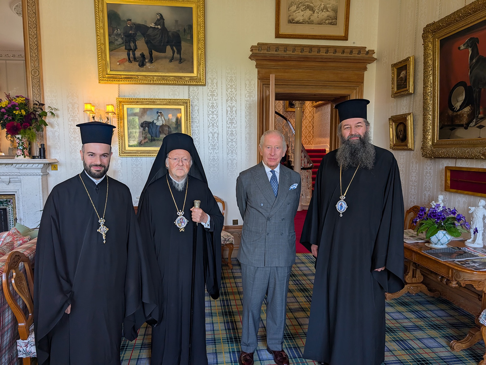
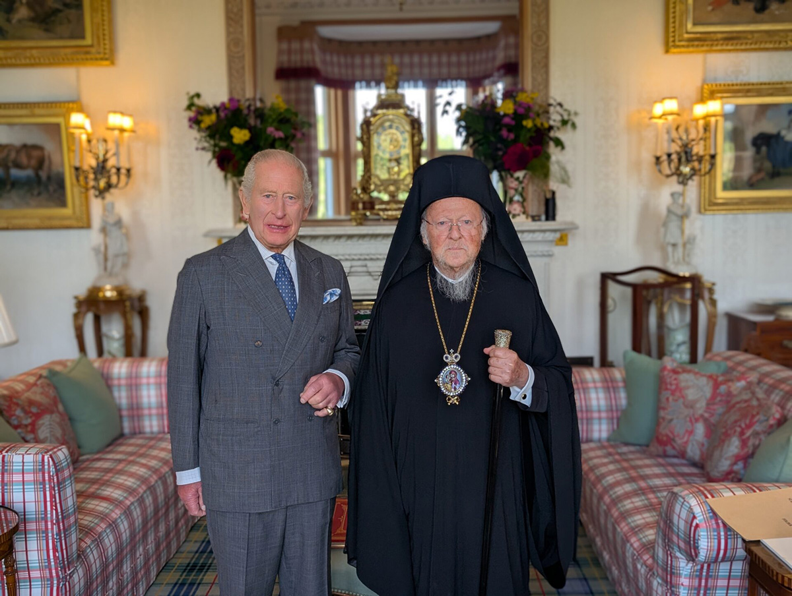

+++
title = "Meeting of the Ecumenical Patriarch with King Charles"
date = 2026-10-05
aliases = ["/2026/10/05/meeting-of-the-ecumenical-patriarch-with-king-charles/"]
description = "Ecumenical Patriarch Bartholomew met King Charles III at Balmoral Castle on 21 September 2026."
image = "king2.jpg"
draft = false
+++

His All-Holiness Ecumenical Patriarch Bartholomew met in the morning of Monday 21 September 2026 with His Majesty King Charles III at Balmoral Castle in Scotland.

This was their second meeting since the British Monarch's accession to the Throne.

Their first meeting took place in October 2022, while in the past His All-Holiness and the then Prince of Wales had also met in London.

By way of exception, the King received the Patriarch in a private meeting at his personal summer residence at Balmoral Castle, and their conversation, although originally scheduled to last half an hour, was extended by a further half hour in a very cordial and friendly atmosphere.

Upon the departure of His All-Holiness the Patriarch, the British Monarch personally accompanied him to the exit of the Castle.

His All-Holiness was accompanied to this important meeting by His Grace Bishop Raphael of Ilion, who ministers in Scotland, and the Very Reverend Grand Ecclesiarch Aetios, Director of the Patriarch's Private Office.

