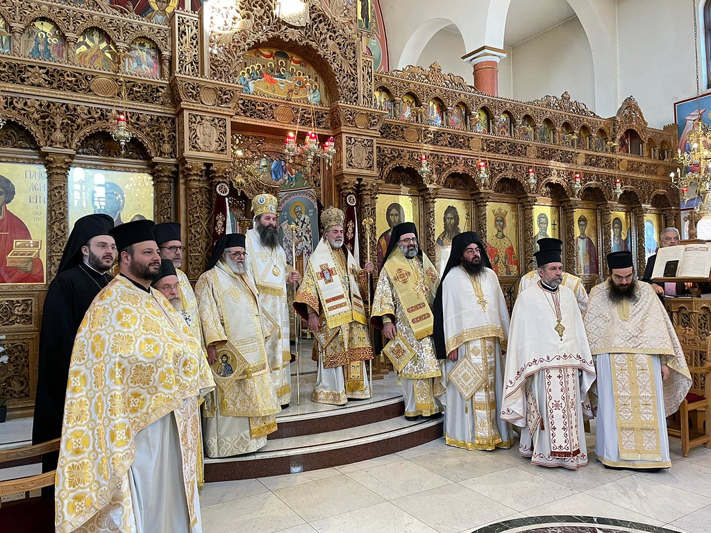

+++
title = "Ordination of Bishop Raphael of Ilion"
date = 2021-03-09
aliases = ["/2021/03/09/ordination-of-archimandrite-raphael-pavouris/"]
description = "Archimandrite Raphael Pavouris was ordained Bishop of Ilion in Harrow on 9 March 2021."
image = "ordination-bishop-raphael.jpg"
draft = false
+++

On Tuesday 9 March 2021, our Priest in Charge Archimandrite Raphael Pavouris was ordained Bishop of Ilion by His Eminence, Archbishop of Thyateira and Great Britain Niketas, at the Greek Orthodox Church of St. Panteleimon and St. Paraskevi (Harrow, London).

His Grace, Bishop Raphael, will be based at St Andrew's Community in Edinburgh and will have under his pastoral care the Communities of the Ecumenical Patriarchate of Scotland and Northern England.

