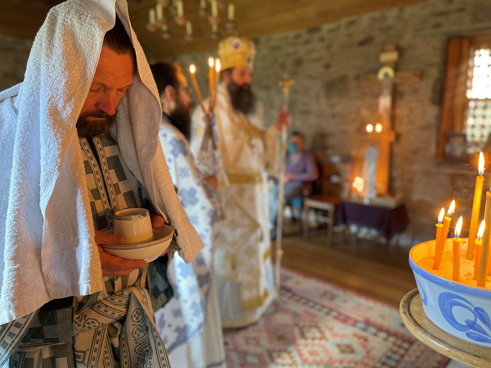

+++
title = "Ordination of Deacon Janis Stumbris"
date = 2021-04-10
aliases = ["/2021/04/10/ordination-to-the-diaconate-of-mr-janis-stumbris/"]
description = "On Saturday 10 April 2021, Bishop Raphael of Ilion ordained Janis Stumbris to the diaconate in Dunblane."
image = "ordination-diaconate.jpg"
draft = false
+++

On Saturday, 10 April 2021, His Grace Bishop Raphael of Ilion ordained to the diaconate Mr Janis Stumbris at the Church of Saints Nicholas and Blane in Dunblane, Scotland.

