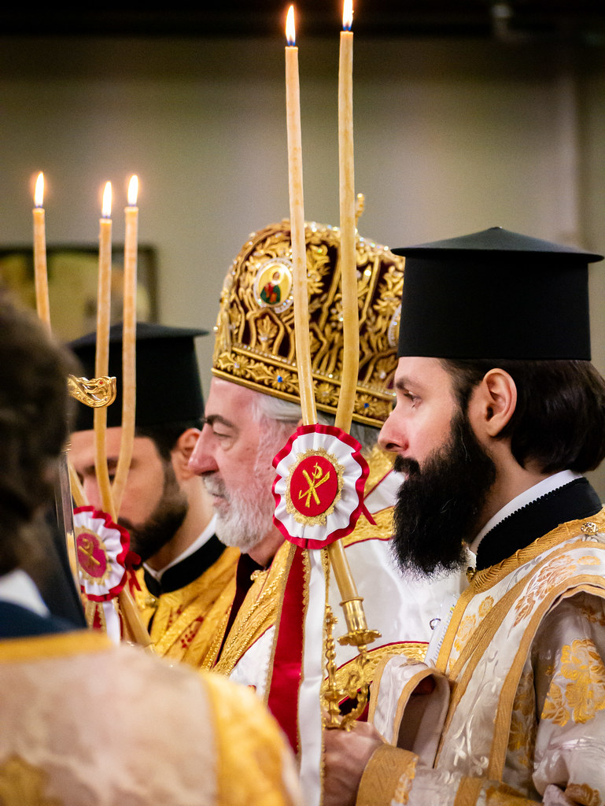

+++
title = "Ordination to the Holy Priesthood of Deacon Caius Anton Gurgu"
date = 2023-12-18
aliases = ["/2023/12/18/ordination-to-the-holy-priesthood-of-deacon-caius-anton-gurgu/"]
description = "Deacon Caius Anton Gurgu was ordained to the Holy Priesthood at St Andrew's in Edinburgh on 10 December 2023."
image = "53395986056_ab6ea96f3f_b.jpg"
draft = false
+++

On Sunday, 10th December 2023, Deacon Caius Anton Gurgu was ordained to the Holy Priesthood at the Church of St Andrew in Edinburgh, Scotland. His Eminence Archbishop Nikitas presided during Matins and concelebrated the Divine Liturgy with His Grace Bishop Raphael of Ilion. Amongst those concelebrating were the V. Rev. Archim. Nektarios Stogiannis, the V. Rev. Archim. Avraamy Neyman, the Rev. Protopresbyter of the Ecumenical Throne Luke Jeffrey, the Rev. Protopresbyter Georgios Schinas, the Rev. Deacon Symeon Menne and Archdeacon Dr. George Tsourous. The congregation was a truly international community, representing a mixed ethnic background, reflecting an ecumenical spirit.

In his ordination speech, Fr Caius reflected on his spiritual journey and the blessings received throughout his life. Born in Romania and influenced by the Orthodox Faith from an early age, he acknowledged the profound impact of his family, particularly his grandparents and parents, in shaping his path. His time at the Monastery of the Dormition of the Theotokos in Romania played a significant role in intertwining his family life with spiritual growth. His journey led him to Edinburgh for studies, where he found a different yet enriching manifestation of Orthodoxy, deeply influenced by the community and clergy there. Fr Caius expressed gratitude for his wife, Thaleia, and their children, emphasising the support and love of his family and community. He embraced priesthood with humility and a sense of divine calling, pledging to serve with the same dedication and care as a father for his children, aspiring to be Christ-like in service. His moving speech concluded with a call for prayers for himself and all the Lord's people, echoing St. Paul's words to fearlessly proclaim the gospel.

In response, among other things, His Eminence Archbishop Nikitas spoke highly of Fr Caius's path to priesthood and his potential impact on the church. He emphasised the Church's need for presbyters like Fr Caius, noting the virtues of humility and obedience, and his progression through life's stages to Scotland, a place yearning for spiritual truth. His Eminence stressed that priests like Fr Caius are crucial for unveiling Orthodoxy anew in Scotland, guiding people back to the truth of Jesus Christ. He remarked that Christ calls not the perfect but those with their own struggles, seeking hearts willing to serve. He encouraged the new priest to arm himself with the armour of God, to be robed in righteousness, to wield the shield of Faith, and to embody Christ fully, as the Apostle Paul advised.

The ordination was fittingly celebrated with a festive luncheon hosted by the community, featuring traditional Christmas carols from Scotland, Greece, and Romania, symbolizing the joy and unity of the occasion.

Photographs from the day.

{{< gallery "53395056957_f47e64da2f_b.jpg" "53395057427_0324091c49_b.jpg" "53395057562_6a48c9bae8_b.jpg" "53395057637_702dddbfe6_b.jpg" "53395057672_e4723f43d5_b.jpg" "53395057717_1b4fa95212_b.jpg" "53395058342_49080f95ec_b.jpg" "53395058417_b8a8851c80_b.jpg" "53395058562_e44b553216_b.jpg" "53395058732_3dd45d26bf_b.jpg" "53395985021_b37ed8f089_b.jpg" "53395986341_4efc5d9946_b.jpg" "53396174338_a0e5a76938_b.jpg" "53396174503_dae1fb7335_b.jpg" "53396175328_82480544c5_b.jpg" "53396176208_0cd6a0cbe8_b.jpg" "53396298044_7eef02da2c_b.jpg" "53396298439_f03f9aea60_b.jpg" "53396299094_2eb6a815c6_b.jpg" "53396425955_a27cc9b486_b.jpg" "53396426325_974fabc855_b.jpg" "53396427085_572480d5ac_b.jpg" "53396427205_4f3dc30cf0_b.jpg" "53396427370_500eaffb9d_b.jpg" >}}
