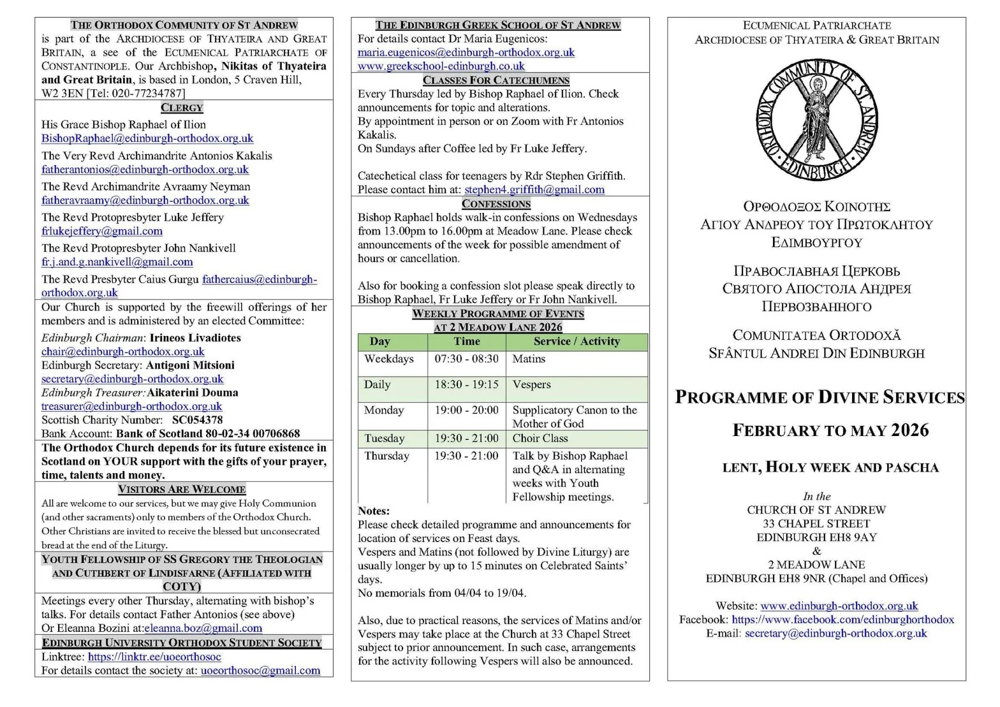
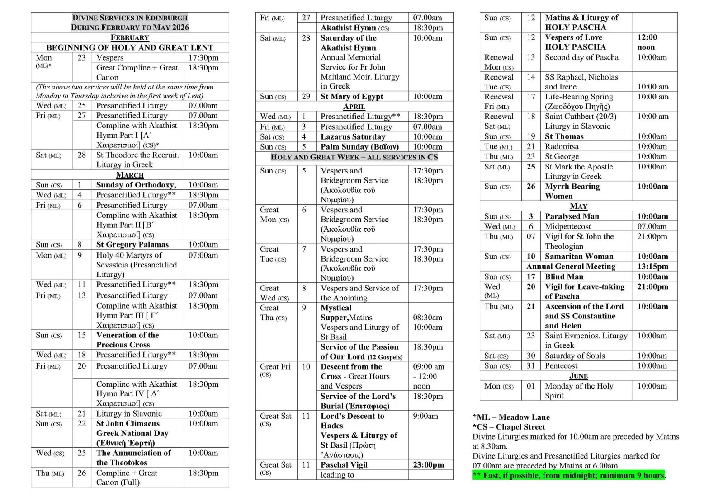

+++
title = "Schedule of services from Lent to Pentecost 2026"
date = 2026-02-21
description = "The programme of divine services in Edinburgh from the beginning of Great Lent to Pentecost 2026."
draft = false
+++

The schedule of services for Lent, Holy Week, Pascha and Pentecost 2026, as planned to take place.

All Divine Liturgies marked for 10.00 am are preceded by Matins at 8.30 am. The Liturgies of the Presanctified Gifts on Fridays are preceded by Matins at 6.00 am. No weekly programme is shared during this period other than activities and alterations, so please keep a copy of this schedule.

A Lent special edition of our community's bulletin, *Spiritual Meadow*, is available on our website. This is issue 6: [edinburgh-orthodox.org.uk/newsletter](https://edinburgh-orthodox.org.uk/newsletter/)

Wishing you a blessed and fruitful Lent, and a joyful journey to Pascha.
