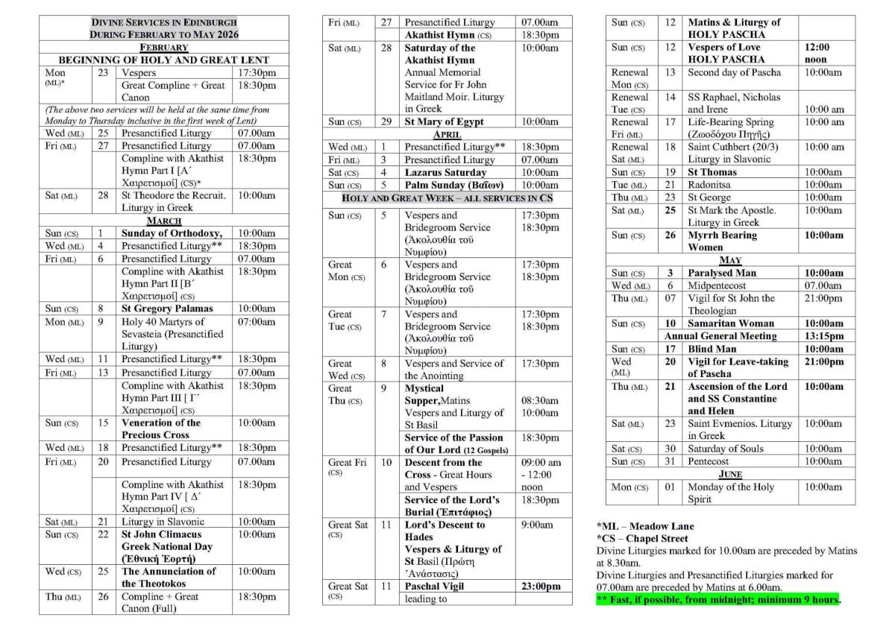

+++
title = "Services: Lent to Pentecost 2026"
date = 2026-02-02
aliases = ["/2026/02/02/services-lent-pentecost-2026/"]
description = "The planned schedule of services for Lent, Holy Week, Pascha and Pentecost 2026."
image = "lent-pentecost-2026-schedule.jpeg"
draft = false
+++

The schedule of services for Lent, Holy Week, Pascha and Pentecost 2026, as planned to take place, is below.

All Divine Liturgies marked for 10.00 am are preceded by Matins at 8.30 am. The Liturgies of the Pre-sanctified Gifts on Fridays are preceded by Matins at 6.00 am. No weekly programme is shared during this period other than activities and alterations, so please keep a copy of this schedule.

